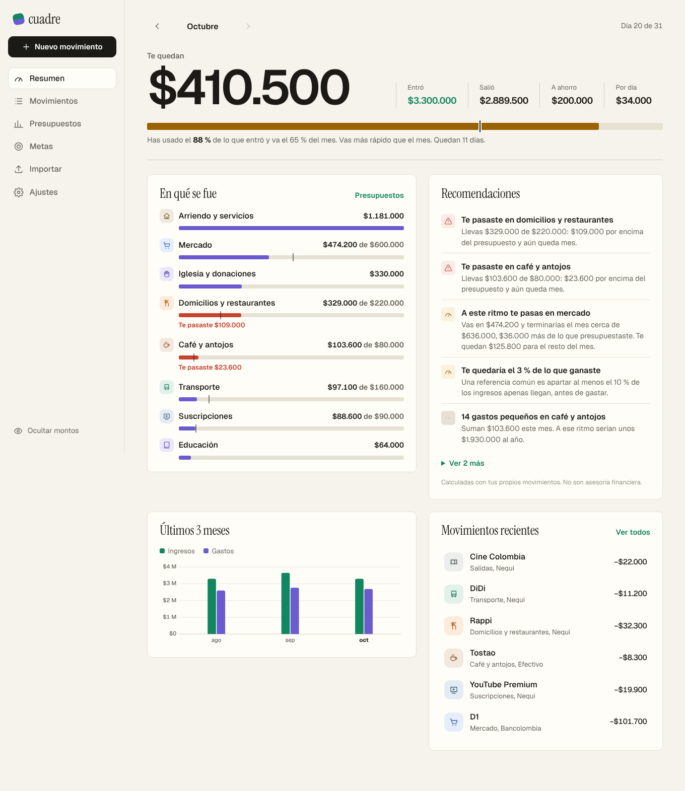
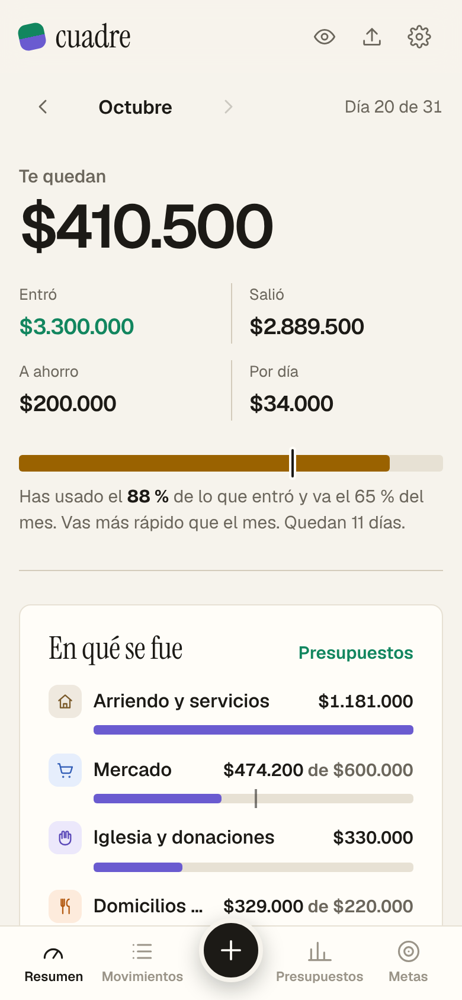
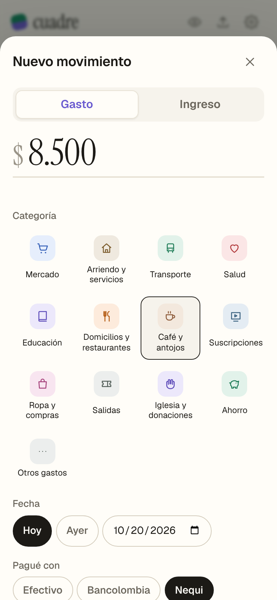
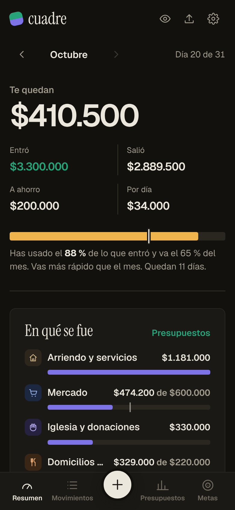

# Cuadre: finanzas personales

App web para llevar las cuentas del mes y recibir recomendaciones calculadas con tu propio historial, no con reglas genéricas. Por ejemplo: "A este ritmo te pasas en mercado", "14 gastos pequeños en café suman $103.600" o "Pagas 4 suscripciones: $88.600 al mes". Está pensada primero para el celular y funciona igual en el computador.

**En vivo:** https://cuadre-lake.vercel.app. La página de presentación está en la raíz (HTML y CSS sin frameworks, en `landing/`) y la app en `/app/`. "Ver con datos de ejemplo" abre la app ya cargada con tres meses de movimientos.



| Resumen en el celular | Registrar un gasto | Modo oscuro |
| --- | --- | --- |
|  |  |  |

## Qué hace

- **Resumen del mes.** Muestra cuánto te queda y una barra de ritmo que compara lo gastado con los días que han pasado ("día 20 de 31: has usado el 88 %"). También cuánto puedes gastar por día hasta fin de mes, en qué se te fue la plata por categoría y la evolución de los últimos meses.
- **Registrar en segundos.** Botón central en el celular, valor con puntos de miles mientras escribes, categorías con ícono, fecha (Hoy, Ayer u otra) y cuenta (Efectivo, Bancolombia, Nequi).
- **Movimientos.** Agrupados por día, con búsqueda sin tildes y filtros por categoría y cuenta. Tocar uno lo edita o lo elimina.
- **Presupuestos por categoría.** Cada uno muestra la barra del mes con la marca del día de hoy. Cuando el ritmo indica que te vas a pasar, avisa antes de que pase. Para las categorías sin presupuesto sugiere un límite según tu promedio.
- **Metas de ahorro.** Cada meta dice cuánto apartar al mes para llegar a la fecha y cuándo la cumples al ritmo actual. Abonar también queda registrado como ahorro del mes.
- **Importar el extracto del banco.** Acepta CSV de Bancolombia, Nequi, Davivienda y similares:
  - Reconoce las columnas solo, sea una columna de valor con signo o columnas de débito y crédito.
  - Clasifica cada movimiento con reglas por comercio (Rappi, D1, Air-e, Netflix...).
  - Marca los que ya estaban registrados.
  - Si corriges una categoría, la recuerda para la próxima vez.
- **Ocultar montos**, para abrir la app en público. Tema claro y oscuro, y respaldo en JSON.

## Las recomendaciones

Todo se calcula en `src/domain/insights.ts`, con funciones puras que se prueban aparte. Hay seis tipos, ordenados de lo urgente a la buena noticia:

| Tipo | Cuándo aparece |
| --- | --- |
| Presupuesto pasado | Lo gastado supera el límite de la categoría. |
| Ritmo | La proyección a fin de mes supera el presupuesto en más del 5 %. |
| Contra tu promedio | Una categoría sin presupuesto va a cerrar 30 % por encima de tu promedio de los 3 meses anteriores (o 30 % por debajo, como buena noticia). |
| Gastos hormiga | 8 o más gastos de menos de $25.000 en gustos, con su valor al año. |
| Suscripciones | Cobros del mismo comercio, de valor parecido (±15 %), en meses seguidos. |
| Ahorro y metas | Cuánto queda de lo que entró y si lo que apartas alcanza para cada meta. |

**La proyección no es una regla de tres.** El arriendo pagado el día 2 no se multiplica por 31/2: los pagos fijos, detectados como cobros que se repiten, cuentan una vez, y si todavía no se han cobrado este mes se suman como pendientes. Solo el gasto variable se proyecta según los días que han pasado.

## Tecnologías

| | |
| --- | --- |
| Interfaz | React 19, TypeScript estricto, Vite, React Router 7 |
| Estado y datos | Redux Toolkit con **RTK Query** sobre un repositorio, con actualizaciones optimistas: el gasto aparece al instante y, si guardar falla, se revierte |
| Gráficos | SVG hecho a mano. Ingresos y gastos con un solo eje, colores validados para daltonismo y tabla equivalente para lectores de pantalla |
| Diseño | Instrument Serif para los títulos y Geist con cifras tabulares para el texto y los montos, fondo de papel cálido, tema claro y oscuro |
| Calidad | Vitest y Testing Library (42 pruebas), oxlint, CI en GitHub Actions |

### Lista para una base de datos

Las pantallas no saben dónde se guardan los datos. Todo pasa por la interfaz `Repository` (`src/data/repository.ts`):

- Hoy la implementa `LocalRepository`, que guarda en el navegador.
- Para tener cuentas de usuario y datos en un servidor basta con escribir otra implementación (Supabase, o una API propia con Node y PostgreSQL) y cambiar una línea en `src/main.tsx`.

```
src/
  domain/       lógica pura: dinero, fechas, totales, proyección, recomendaciones, suscripciones, metas, CSV
  data/         Repository (la interfaz), LocalRepository y la API de RTK Query
  features/     preferencias (tema, ocultar montos)
  components/   Layout, hoja de nuevo movimiento, gráfico, filas, íconos
  pages/        Resumen, Movimientos, Presupuestos, Metas, Importar, Ajustes, Bienvenida
landing/        página de presentación (HTML y CSS), se copia a la raíz del sitio al compilar
tests/          dominio y flujos completos de la app
```

## Correr el proyecto

```bash
npm install
npm run dev        # http://localhost:5173
npm test
npm run build      # dist/: la presentación en la raíz y la app en dist/app/
```

En Windows con PowerShell usa `npm.cmd` en lugar de `npm`.

**Sin instalar nada:** `portable/index.html` se abre con doble clic. Se regenera con `npm run build:portable`.

## Licencia

MIT. Orlando Castillo, 2026.
